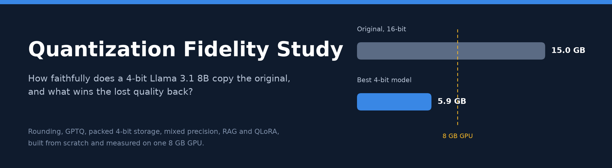
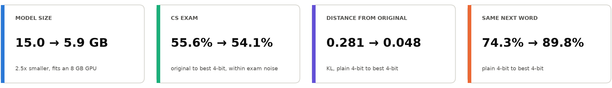
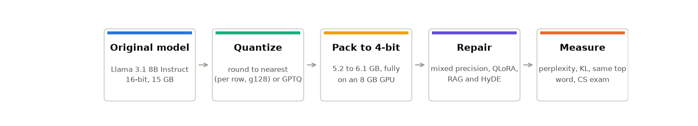
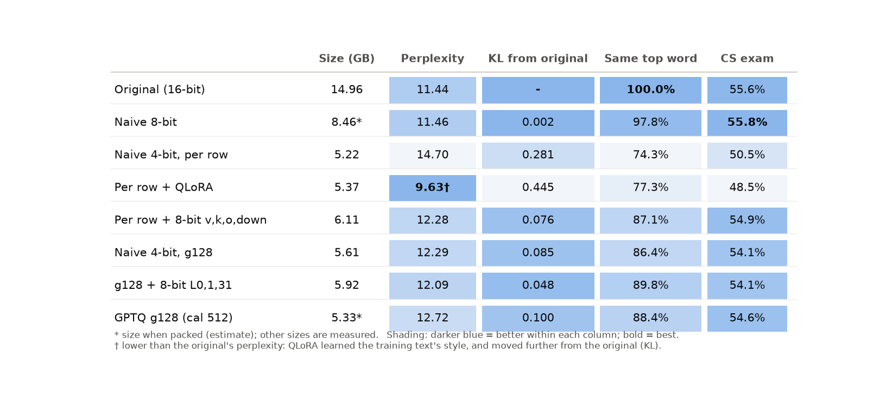
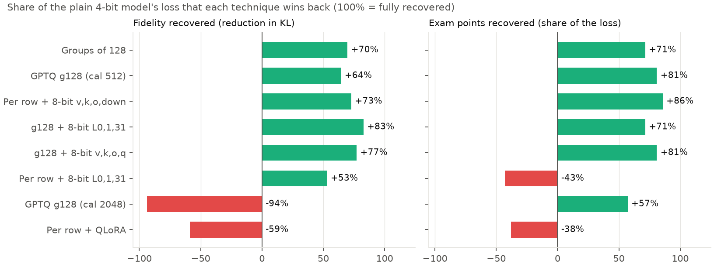
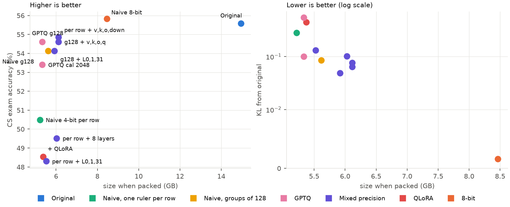
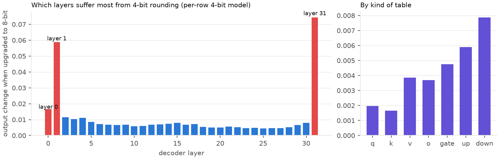
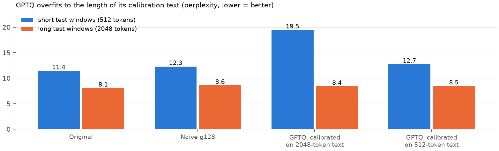
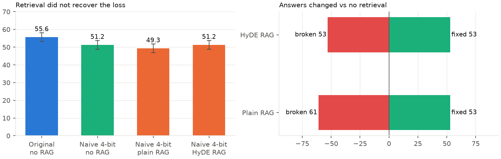
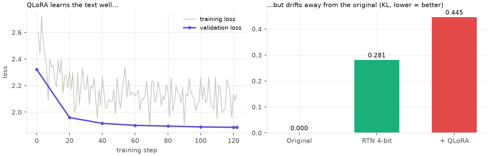

<p align="center"></p>

<p align="center">
  
  
  
  
  
</p>

<p align="center">
  <a href="#results">Results</a> &nbsp;·&nbsp;
  <a href="#findings">Findings</a> &nbsp;·&nbsp;
  <a href="#how-it-works">How it works</a> &nbsp;·&nbsp;
  <a href="#evaluation">Evaluation</a> &nbsp;·&nbsp;
  <a href="#details">Details</a> &nbsp;·&nbsp;
  <a href="#reproduce">Reproduce</a> &nbsp;·&nbsp;
  <a href="#limitations">Limitations</a>
</p>

<p align="center"></p>

> [!IMPORTANT]
> **Headline.** Plain 4-bit rounding makes an 8B model fit a consumer GPU but costs quality: a computer-science exam falls from 55.6% to 50.5%, and the model picks a different next word than the original one time in four. Rounding in finer groups and keeping the most fragile layers at 8-bit recovers most of it. The best combination is the closest 4-bit model to the original, at 5.9 GB, fully on an 8 GB GPU. Retrieval (RAG, HyDE) and QLoRA fine-tuning did **not** help, and are reported as negative results.

## Overview

An 8B-parameter model in 16-bit needs 15 GB, which does not fit an 8 GB GPU. Rounding its weights to 4 bits shrinks it about three times. This project measures what that costs relative to the **original model's behaviour**, not only a benchmark score, and tests which techniques win it back. Every method is built from scratch and evaluated by one shared harness, on one machine, with free tools.

<p align="center"></p>

## Results

<p align="center"></p>

| Measure | What it tells you |
|:--|:--|
| **KL from original** | How far the model's whole prediction distribution is from the original's. 0 is identical. The most sensitive measure of fidelity. |
| **Same top word** | How often the model's most likely next word equals the original's. |
| **CS exam** | 412 computer-science multiple-choice questions (four MMLU subjects), 0-shot. Uncertainty is about ±2.5 points, so smaller differences cannot be resolved. |
| **Perplexity** | Surprise on unseen WikiText-2 text. Lower is better, but it rewards training on similar text, so it is never read alone. |

### What each technique recovers

<p align="center"></p>

Left: how much of the plain 4-bit model's distance from the original each technique removes. Right: the share of the exam points it wins back. Green is recovery, red is damage. Finer groups and mixed precision recover most of the loss; a poorly calibrated GPTQ and QLoRA make it worse.

### Size against quality

<p align="center"></p>

## Findings

| | Finding | Evidence |
|:-:|:--|:--|
| **1** | **8-bit is essentially free; 4-bit is not.** | 8-bit: exam 55.8% (original 55.6%), KL 0.002. Plain 4-bit: 50.5%, KL 0.281. |
| **2** | **A finer rounding ruler is the cheapest fix.** | Groups of 128: exam 54.1%, KL 0.085, 5.61 GB (+0.4 GB over plain 4-bit). |
| **3** | **Fragility is concentrated.** | Layers 1, 31 and 0, and the `v`, `k`, `o` and `down` tables, suffer most. Protecting those kinds at 8-bit lifts the per-row model from 50.5% to 54.9% (+0.9 GB). |
| **4** | **The two fixes combine.** | Groups of 128 plus 8-bit for layers 0, 1 and 31: KL **0.048**, same next word **89.8%**, 5.92 GB. The best fidelity of any 4-bit model. |
| **5** | **GPTQ is sensitive to its calibration text.** | Matches groups-of-128 rounding on short text and beats it on long text, but calibrated on 2048-token text it collapses on 512-token windows (perplexity 19.5 against 12.3). |
| **6** | **Retrieval did not help.** | Over 10,751 Wikipedia passages: plain RAG 49.3%, HyDE 51.2%, against 51.2% without retrieval. As many answers were broken as fixed. |
| **7** | **Training toward the wrong target backfires.** | QLoRA cut perplexity to 9.63 (below the original's 11.44) but raised KL from 0.281 to 0.445 and the exam fell to 48.5%. It learned the text's style, not the original's behaviour. |

## How it works

| Technique | What it does | Code |
|:--|:--|:--|
| **Round to nearest**, per row or groups of 128 | Snaps each weight to the nearest of 16 (4-bit) or 256 (8-bit) levels; each row or group has its own scale and zero-point | `quantization/naive_ptq.py`<br>`quantize_checkpoint.py` |
| **Packed 4-bit storage** | Two 4-bit integers per byte plus scales, unpacked layer by layer. Weights are bit-identical to the simulated version: 5.2 GB instead of 15 GB | `quantization/packed.py`<br>`make_packed.py` |
| **GPTQ** | Rounds one column at a time and adjusts the remaining columns to cancel the error, using calibration text | `quantization/gptq.py`<br>`run_gptq.py` |
| **Mixed precision** | Measures which layers and tables hurt most when rounded and keeps those at 8-bit under a fixed size budget | `quantization/mixed_sensitivity.py`<br>`plan_mixed.py` |
| **RAG and HyDE** | Retrieves passages with a small embedding model; HyDE searches with a passage the model writes itself | `rag/` |
| **QLoRA** | Trains 41.9 M adapter parameters on the frozen packed 4-bit model | `quantization/train_qlora.py` |

Models are produced layer by layer straight from the saved weight files, so the 15 GB original never has to fit in memory.

## Evaluation

| Principle | How it is applied |
|:--|:--|
| **Identical inputs** | The same WikiText-2 text and the same 412 questions for every model. The original model's predictions are stored once and every other model is compared with that file. |
| **Separate text for choosing and reporting** | Choices such as which layers to protect use WikiText *validation* text. Every reported number uses the test text and the exam. |
| **Trusted scoring** | The retrieval-aware exam scorer reproduces the standard `lm-evaluation-harness` result question by question on 404 of 412 questions before any retrieval number is used. |
| **No contamination** | Passages sharing an 8-word run with any exam question were removed from the retrieval library. |
| **Paired comparison** | Answers are compared question by question (fixed versus broken, sign test), not only as totals. |
| **Honest reporting** | Settings were fixed before looking at exam results. Failures are reported as they are. |

## Details

<details>
<summary><b>Full results table</b></summary>

&nbsp;

| Model | Perplexity | KL from original | Same top word | Exam (50 q) | Exam (412 q) | Size (GB) |
|:--|:-:|:-:|:-:|:-:|:-:|:-:|
| Original (16-bit) | 11.44 | - | 100% | 66% | 55.6% | 14.96 |
| Naive 8-bit | 11.46 | 0.002 | 97.8% | 66% | 55.8% | 8.46 * |
| Naive 4-bit, per row | 14.70 | 0.281 | 74.3% | 58% | 50.5% | 5.22 |
| Per row + QLoRA | 9.63 | 0.445 | 77.3% | 58% | 48.5% | 5.37 |
| Per row + 8-bit layers 0, 1, 31 | 13.03 | 0.132 | 83.6% | 54% | 48.3% | 5.52 |
| Per row + 8-bit 8 layers | 12.67 | 0.101 | 84.4% | 60% | 49.5% | 6.03 |
| Per row + 8-bit v, k, o, down | 12.28 | 0.076 | 87.1% | 62% | 54.9% | 6.11 |
| Naive 4-bit, groups of 128 | 12.29 | 0.085 | 86.4% | 64% | 54.1% | 5.61 |
| g128 + 8-bit layers 0, 1, 31 | 12.09 | **0.048** | **89.8%** | 68% | 54.1% | 5.92 |
| g128 + 8-bit v, k, o, q | 12.07 | 0.064 | 88.6% | 68% | 54.6% | 6.11 |
| GPTQ g128 (calibrated on 512 tokens) | 12.72 | 0.100 | 88.4% | 66% | 54.6% | 5.33 * |
| GPTQ g128 (calibrated on 2048 tokens) | 19.45 | 0.543 | 80.3% | 64% | 53.4% | 5.33 * |

\* Estimated size when packed; all other sizes are measured on real packed models. The packed groups-of-128 format stores 32-bit scales, which is why it is larger than the compact estimate; a leaner format would be about 5.3 GB.

Regenerate with `python evaluation/plot_results.py` (also writes `results/summary.md`).

</details>

<details>
<summary><b>Mixed precision: which parts are fragile</b></summary>

&nbsp;

<p align="center"></p>

Each trial upgrades one group to 8-bit and measures how much the output changes (KL). Layers 0, 1 and 31 dominate. On the finer groups-of-128 model the same layers stand out, about four times less (`results/figures/sensitivity_g128.png`).

</details>

<details>
<summary><b>GPTQ and the calibration-length lesson</b></summary>

&nbsp;

<p align="center"></p>

Calibrated on 2048-token windows, GPTQ is excellent on 2048-token test windows and fails on 512-token ones. Recalibrating on matching text fixes it. Naive rounding never sees data, so it is unaffected.

</details>

<details>
<summary><b>Retrieval (RAG and HyDE) on the 4-bit model</b></summary>

&nbsp;

<p align="center"></p>

Retrieval repaired about 60% of the answers the damage had broken (36 of 60) but broke about 29% of previously correct ones. Several reasons are plausible and untested: the questions mostly test reasoning and code reading rather than recall, long retrieved context can distract a small damaged model, and a made-up HyDE passage mostly reflects what the model already knows.

</details>

<details>
<summary><b>QLoRA on the 4-bit model</b></summary>

&nbsp;

<p align="center"></p>

Training for next-word prediction on WikiText made the model better at WikiText and worse at being the original. Distillation toward the original model's predictions is the natural next experiment.

</details>

<details>
<summary><b>Repository layout</b></summary>

```
quantization/   rounding, GPTQ, packed storage, mixed precision, QLoRA, evaluation entry points
rag/            library builder, embedder, retriever, HyDE, exam scorer
evaluation/     figures, summary table, report generator
results/        every measurement (JSON), figures, per-question outcomes
evaluate.py     shared metrics: perplexity, fidelity (KL, same top word), memory, latency
test_*.py       unit tests for the rounding math, packed storage and GPTQ
```

</details>

## Reproduce

Requires Python 3.11, an NVIDIA GPU with 8 GB, 16 GB RAM, about 60 GB of free disk and access to the gated Llama 3.1 8B Instruct weights on Hugging Face. Everything uses free tools and free hardware.

```bash
python -m venv venv && venv\Scripts\activate      # PowerShell: .\venv\Scripts\Activate.ps1
pip install -r requirements.txt

python test_packed.py && python test_gptq.py       # unit tests, no model needed

# measure the original once; this also stores the prediction file other models are compared with
python quantization/evaluate_checkpoint.py --model meta-llama/Llama-3.1-8B-Instruct --name baseline --method bf16 --save-reference

# build and measure a real packed 4-bit model
python quantization/make_packed.py --bits 4
python quantization/evaluate_checkpoint.py --packed --model quantized_models/packed_naive_4bit --name packed_naive_4bit --method naive_rtn_packed --bits 4

# mixed precision: measure sensitivity, plan layouts, build one
python quantization/mixed_sensitivity.py && python quantization/plan_mixed.py
python quantization/make_packed.py --bits 4 --plan results/mixed/plan_types.json --out quantized_models/packed_mixed_types

# retrieval and QLoRA
python rag/build_corpus.py && python rag/build_index.py
python rag/run_rag_eval.py --model quantized_models/naive_4bit --name naive_quant_4bit --modes none hyde_gen plain hyde
python quantization/train_qlora.py --max-tokens 1000000

python evaluation/plot_results.py                  # figures and results/summary.md
```

Evaluating a packed model takes about ten minutes on the reference machine.

## Limitations

> [!NOTE]
> - One model, one domain (computer science) and a 412-question exam with about ±2.5 points of noise. The exam can no longer separate the best 4-bit models from each other or from the original; the fidelity measures, built on thousands of predictions, are the more sensitive evidence.
> - The headline mixed-precision exam gain has p = 0.08 on exam answers alone.
> - Fidelity is measured on WikiText text; behaviour on other text was not measured.
> - Generation is slow (about 1.5 tokens per second) because packed layers are unpacked in plain PyTorch. Real 4-bit speed needs compiled kernels that could not be built on this Windows setup.
> - Not yet done: distillation-style QLoRA, the full 57-subject MMLU, comparison with GPTQModel and bitsandbytes, and a deployed demo.

## Licensing and data

The code in this repository is released under the [MIT License](LICENSE). Llama 3.1 is released by Meta under the Llama 3.1 Community License; this repository contains no model weights. Datasets: WikiText-2 (perplexity and calibration), MMLU (exam), and Wikipedia text under CC BY-SA for the retrieval library, which is downloaded locally and not redistributed here.

<p align="center"><sub>Sarib Azim &nbsp;·&nbsp; github.com/SaribAzim</sub></p>
